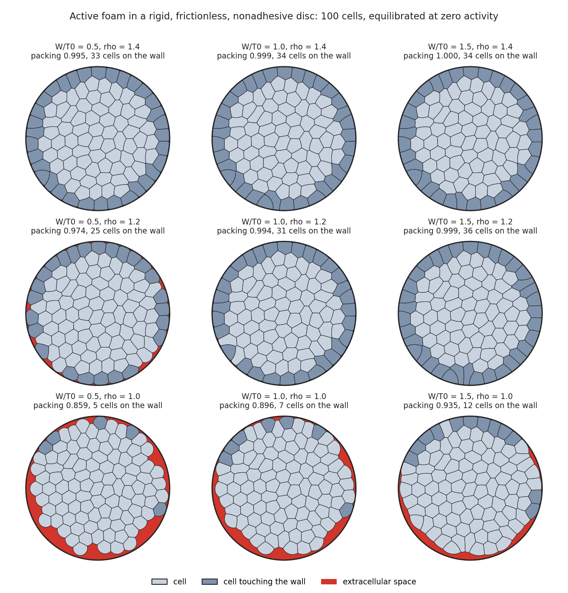

# Active foam inside a rigid circular wall

The curved-edge active-foam model of `activefoam/foam_full.py`, confined in a disc of
fixed radius instead of a periodic box. Cells have areas and curved boundaries,
extracellular spaces can form, and neighbours exchange through the same T1–T4
transitions. The wall is rigid, frictionless and nonadhesive: it stops outward motion,
allows sliding, and lets cells detach inward. Nothing in `activefoam/` is modified.

Plan, conventions and status: [`PLAN.md`](PLAN.md). Measured benchmark errors:
[`BENCHMARKS.md`](BENCHMARKS.md).

## Model

Interior physics is unchanged. With `T_eff = max(T, 0)` and
`p_n = P0*(rho/A - 1)/sqrt(rho)`, each film segment of length `l` puts on each of its
two end nodes

```
f = T_eff * t  +  (p_n,left-to-right difference) * (l/2) * n
```

and a node moves by `psi*dt*f` per step (`psi = sqrt(rho)`). Tensions follow the same
Ornstein–Uhlenbeck update. Pressure normals come from the oriented cell boundary and
areas from the current step.

Wall, for a node at the wall with outward normal `n`:

```
F_wall = -max(0, F.n) n
```

Numerically each step is: forces, trial Euler step, radial projection of any node
outside the wall, wall records, then film remeshing. The recorded nodal reaction is
`(x_projected - x_trial)/(psi*dt)`. Disc radius is `R_w = sqrt(N/pi)`, so the mean area
per cell is 1 and `rho` is the preferred area, as in the periodic box.

## Files

| File | Content |
|---|---|
| `tiling.py` | Voronoi tiling clipped to the disc; outer films sampled on the wall |
| `kernels.py` | disc integration kernel; finiteness, crossing and nesting diagnostics |
| `disc.py` | `DiscFoam`: wall step, Euclidean geometry, guarded transitions |
| `state.py` | attribute tables; snapshot, restore and difference report |
| `protocol.py` | preparation, evolve and validate for the disc and matched periodic runs |
| `measure.py` | packing fraction, wall reaction and traction, wall layer vs interior |
| `benchmarks.py` | wall benchmarks with explicit numerical parameters |
| `scripts/wall_benchmarks.py` | regenerates `BENCHMARKS.md` |
| `scripts/pilot_compare.py` | pilot disc vs periodic comparison and the configuration figure |

## Use

```python
import numpy as np
from circle import protocol
from circle.measure import zone_statistics, wall_load, traction_profile

foam = protocol.equilibrated(n_cells=36, w=1.0, rho=1.3, seed=1)   # relax, seed spaces, anneal, quench
print(zone_statistics(foam))            # packing, contact number, shape, area by zone
print(wall_load(foam.wall)["total"])    # integrated wall reaction of the last step

protocol.evolve(foam, duration=50.0, mu=1.0)                        # active run, tau_R units
print(foam.log.counts(), foam.log.counts("rejected"))               # transitions by kind
```

`DiscFoam.random(n_cells, seed, w=..., rho=...)` gives the raw clipped tiling;
`DiscFoam.from_closed_cells(radius, [ring, ...])` builds detached cells for validation.

## Tests

```bash
python -m pytest tests -q
```

```bash
python -m pytest circle/tests -q -rP
```

`-rP` prints each benchmark's time step, spacing, duration, equilibrium criterion and
measured error.

| Test file | What it gates |
|---|---|
| `test_tiling.py` | trivalent clipped network, arc-sampled outer films, contact-number identity, chord deficit, static box independence |
| `test_wall.py` | planar force law preserved, no penetration, free cell, squeezed-cell traction (fixed mesh and remeshing), detachment, projection vs constraint, joint refinement |
| `test_transitions.py` | attribute classification, snapshot completeness, rejection and rollback for every transition kind, wall-adjacent accepted events, determinism |
| `test_consistency.py` | crossing and nesting diagnostics, Euclidean audit, box independence over an active run |
| `test_measure.py` | node counting, traction units, zones, dynamics recorder |
| `test_disc_acceleration.py` | compiled kernel against its pure-Python execution |

## What the checks show

All numbers below are from this repository's tests and scripts; parameters and errors are
tabulated in [`BENCHMARKS.md`](BENCHMARKS.md).

**The planar force law is preserved.** With the wall moved to infinity the disc kernel
reproduces the planar accelerated step exactly and the planar pure-Python step to 3e-14.

**Confinement.** No node leaves the disc in active runs (largest `r/R_w - 1` is 9e-16).
An isolated cell far from the wall reaches the planar free-cell area to 0.06% with zero
wall reaction. A cell that prefers a smaller area detaches and reaches its free state.

**Wall traction, full contact.** For one squeezed cell the integrated traction matches
`2*pi*R_w*(p_n - T_eff/R_w)` to 1.8%, 0.45% and 0.11% at spacings 0.15, 0.075 and 0.0375
(second order). With remeshing on, a cell that grows onto the wall recovers the same
errors; on a fixed mesh the stretched spacing roughly doubles them.

**Wall traction, partial contact.** For three cells touching the wall over short arcs
the mean reaction changes by 6.0%, 2.4% and 0.5% over three successive halvings of time
step and spacing. At the default spacing it is about 9% above the finest level.

**Projection against the continuous constraint.** On a fixed mesh the nodal estimate
`(x_projected - x_trial)/(M dt)` differs from `max(0, f.n)` by 7e-8, 3e-8 and 2e-8 at
`dt`, `dt/2` and `dt/4` (first order).

**Remeshing and contact.** Plain resampling can temporarily remove wall contact;
wall-aware resampling remains optional and off by default. The regenerated comparison
uses corrected preparation, geometry checks every 100 steps and at the end, and paired
seed differences. See `BENCHMARKS.md` and `data/resampling_comparison.json` for valid and
failed runs. The earlier raw-tiling averages are superseded; they were not validated.
All three plain runs completed; two wall-aware runs failed geometry checks,
leaving one valid pair (21.50 versus 21.67, difference 0.1733). There is no estimable
between-seed uncertainty for one pair. No equivalence or absence of bias is inferred.

**Transitions.** All five transition kinds occur within one cell length of the wall
and are accepted. No transition left the disc naturally in these runs; rejection and
rollback are exercised with controlled fixtures. A rejected or declined attempt restores
the physical state and the random generator exactly, and consumes no random draws.

**Auxiliary box.** Audit mode finds no periodic shift in active runs, and runs in boxes
of 8, 16 and 1000 `R_w` at fixed absolute coordinates are bitwise identical.

## Geometry acceptance and continuation

`protocol.validate(..., strict=True)` rejects resolved film crossings, nesting,
nonfinite geometry, excessive area and wall penetration. Crossing diagnostics cover
self-crossings and crossings between films, including films sharing a junction.
A local fold is tolerated only when the crossing is within `0.01*2*sqrt(pi)` of both
participating endpoints, and those endpoints are identical or connected by free films
shorter than that threshold (the split junctions around a collapsed space). Nearby
unrelated vertices do not provide an exemption. Accepted microfolds remain explicitly
reported as `geometry_status="tolerated_microfolds"`; this is a numerical tolerance,
not a demonstration of physical validity or convergence. Checks count proper segment
crossings; the pilot checks geometry every 100 steps and at each stage end.

`strict=False` reports resolved crossings instead of rejecting them. It is for diagnosis,
not accepting scientific runs. The periodic comparator retains its original per-cell
geometry checks; it does not acquire the disk's extra inter-film diagnostic.

Successive calls to `protocol.evolve` on a disk now continue its transition cadence by
default. Observer times remain relative to each call. An explicit `start` overrides the
cadence index. The two suites can also be collected together:

```bash
python -m pytest tests circle/tests -q
```

## Pilot comparison with the periodic box

Two seeds per point, 100 cells, equilibrated at zero activity
(`scripts/pilot_compare.py`; data in `data/pilot_compare.json`). All 36 runs passed
on rerun. Among the 18 disk endpoints, 12 were clean and six had tolerated local
microfolds. Acceptance is conditional on the stated geometric tolerance and sampled
check cadence, not a claim of overlap-free trajectories at every instant. This is a
pilot, not a production ensemble.



| W/T0 | rho | disc packing | cells on wall | interior z (disc) | z (periodic) | interior shape (disc) | shape (periodic) | interior area (disc) | area (periodic) | wall reaction |
|---|---|---|---|---|---|---|---|---|---|---|
| 0.5 | 1.0 | 0.859 | 7.5 | 5.75 | 6.00 | 3.779 | 3.776 | 0.861 | 1.000 | 1.8 |
| 0.5 | 1.2 | 0.973 | 25.5 | 5.94 | 6.00 | 3.807 | 3.777 | 0.973 | 1.000 | 21.7 |
| 0.5 | 1.4 | 0.995 | 31.0 | 5.96 | 6.00 | 3.813 | 3.778 | 0.994 | 1.000 | 69.0 |
| 1.0 | 1.0 | 0.895 | 9.5 | 5.77 | 6.00 | 3.819 | 3.795 | 0.898 | 1.000 | 2.0 |
| 1.0 | 1.2 | 0.993 | 30.5 | 5.96 | 6.00 | 3.835 | 3.797 | 0.994 | 1.000 | 29.6 |
| 1.0 | 1.4 | 0.999 | 32.5 | 5.96 | 6.00 | 3.836 | 3.799 | 0.999 | 1.000 | 82.9 |
| 1.5 | 1.0 | 0.933 | 14.5 | 5.85 | 6.00 | 3.859 | 3.811 | 0.934 | 1.000 | 2.5 |
| 1.5 | 1.2 | 0.999 | 34.5 | 6.01 | 6.00 | 3.848 | 3.816 | 1.000 | 1.000 | 43.2 |
| 1.5 | 1.4 | 1.000 | 33.0 | 5.97 | 6.00 | 3.865 | 3.819 | 1.000 | 1.000 | 98.0 |

Two things stand out.

- **At `rho = 1` the disc is not the periodic box.** The periodic tissue is confluent
  with cell area 1. In the disc the tissue shrinks to cell areas of 0.86–0.93 and leaves
  the wall almost everywhere. A periodic box holds a tissue in tension; a nonadhesive
  wall can only push. `rho` acts as a confinement parameter in the disc only once the
  tissue presses on the wall, here from about `rho = 1.2`.
- **Under compression the interior is close to the periodic values.** For `rho >= 1.2`
  interior contact number is 5.94–6.01 against 6.00 and interior cell area is within 3%.
  The interior shape factor differs between the domains; interpretation must use only accepted seed pairs. Whether
  that difference shrinks with system size has not been tested.


## Limits

- Films are polylines. At full wall coverage the cells fall short of the disc area by
  about `(spacing/R_w)^2/6`.
- Total wall reaction in partial contact converges more slowly than in full contact;
  see the three-cell table in `BENCHMARKS.md`.
- No shear protocol: a frictionless wall cannot impose shear.
- Under compression, collapsed extracellular spaces can persist as local microfolds.
  They are reported separately from clean geometry and require timestep and spacing
  convergence before quantitative claims. Resolved crossings abort strict runs.
- Adhesions below `W/T0 = 0.5`, where the planar model tangles, have not been run in
  the disc beyond the transition tests.
- The preparation relaxes the tiling at `W = 0`, `rho = 1` before switching to the target
  parameters, as the planar protocol does. Relaxing at high adhesion instead produced
  deep folds in interior cells.
