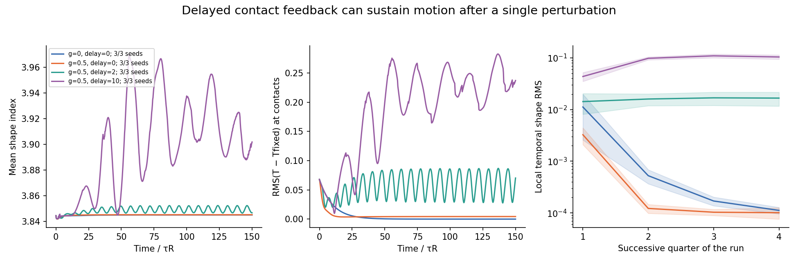
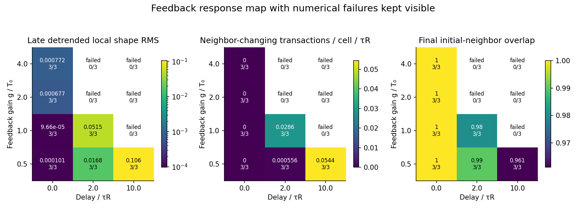
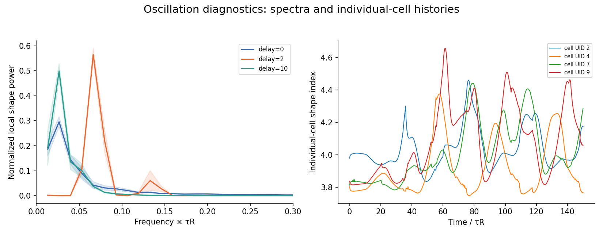
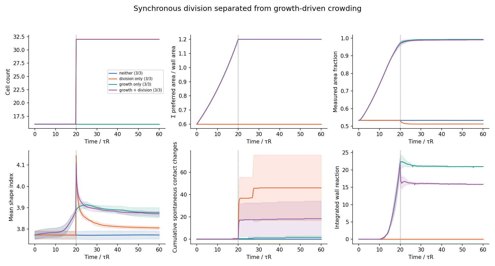
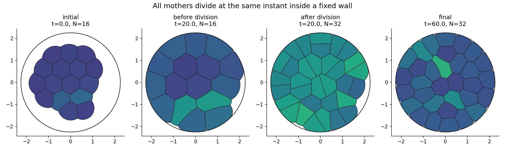
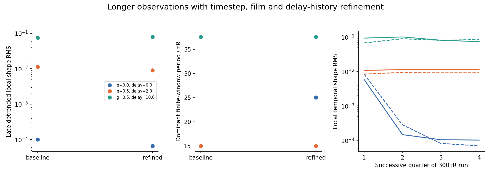
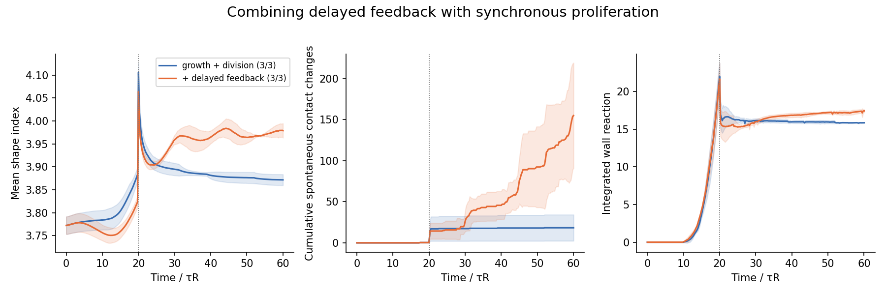

# Delayed feedback and synchronous division

Main pilot: 36/51 runs completed. Full regression suite: 170 tests pass. Failures remain excluded from physical averages.

## Model choices

Feedback changes the tension drift explicitly: τT dT/dt = −(T−Tfixed) + g tanh(ε(t−d)/0.1) + μζ. The sensor ε is relative total contact-length change for a persistent pair of cell IDs. Free films have no feedback. References are set when contacts are born; lost/reformed contacts and daughter contacts receive fresh references and zero prehistory. Raw tensions may be negative; the existing Heaviside rule is retained in the mechanical force. Delayed histories use linear interpolation on a fixed sampling grid.

Division is synchronous and atomic. Plans are constructed from the pre-round tissue; all current mothers divide with no intervening mechanics or random draws. The cleavage normal follows the mother’s major area-moment axis. Deterministic angle adjustments avoid existing junctions and coincident neighboring cleavage sites. A failed split restores the whole round, including cell count, preferred areas, lineage, feedback history, geometry, connectivity, caches and RNG.

Cleavage preserves total K and splits it in proportion to equal daughter areas, so the osmotic pressure is continuous at that instant. Each daughter keeps the original cortical-tension law; the new shared film starts at 2T₀−W. This is geometric cleavage, without a resolved mitotic rounding or contractile-ring stage. Growth changes K separately. All coordinate, mobility, pressure and time scales remain fixed to the founding cells. The circular wall never expands.

## Interpretation limits

Feedback-only runs have no ongoing tension noise; division pilots use μ=0.05. The existing seeded random ordering of eligible topology operations is retained. Growth and division are independently controlled. New daughter identities and cell count changes are not counted as spontaneous neighbor exchanges. Neighbor overlap is restarted at each division round. Finite-window spectral peaks alone do not establish sustained oscillations; amplitude persistence and numerical sensitivity must be assessed alongside them. Strong feedback can still produce invalid crossings.

Validation runs every 0.1τR during evolution, plus a selected every-timestep feedback audit; preparation keeps its established 0.5τR cadence and the existing local microfold tolerance. Three seeds per pilot point, one selected seed for resolution checks. Bands show seed SD; a single accepted seed has no estimated seed uncertainty. No physical phases are assigned to numerical failures.

Raw records are in circle/data/biology_20261114 and circle/data/biology_refinement_20261114. See circle/BIOLOGY.md for implementation, equations and reproduction.

## Delayed contact feedback can sustain motion after a single perturbation

No ongoing stochastic forcing: μ=0. A common deterministic tension kick initializes each run. Left and middle are seed 1; right averages local shape variability over completed seeds (bands: seed SD). Gain g multiplies tanh(delayed relative contact stretch / 0.1). The zero-delay case is an essential control. This is an explicit extension of the original tension law.

## Feedback response map with numerical failures kept visible

N=16, ρ=1.2, W/T₀=1, τT=10τR. Each tile uses only completed runs and reports accepted/attempted seeds. Failed geometries are not assigned a physical phase. The fluctuation map uses a logarithmic color scale. A spectral peak or large RMS alone does not establish an oscillatory phase.

## Oscillation diagnostics: spectra and individual-cell histories

Spectra average power over cells after linear detrending and a Hann window, then normalize per seed; the last half of each run is used. Individual histories show the four most variable cells of the seed-1, g=0.5, delay=10 run, selected for illustration. Their selection is not an unbiased estimate of tissue-wide amplitude.

## Synchronous division separated from growth-driven crowding

Start with 16 cells at ρ=0.6; wall area stays fixed. Growth doubles every mother’s K over 0–20τR and then stops. At t=20τR, all current mothers divide in one atomic round where enabled. Daughters split K and area equally, conserving total K at cleavage. New daughter contacts start at 2T₀−W. Division itself is excluded from spontaneous contact-change counts; subsequent rearrangements are included. Shape means compare different populations across cleavage.

## All mothers divide at the same instant inside a fixed wall

Growth + division, seed 1. Colors show shape index on a common 3.5–4.7 scale. Before and after cleavage share the same timestamp and tissue outline; the new internal daughter contacts change cell shapes without moving the old boundary nodes. The simulation takes no mechanical step between mother splits.

## Longer observations with timestep, film and delay-history refinement

Seed 1, selected after the pilot. Baseline dt=0.005, film spacing=0.1, history spacing=0.05; refined values are 0.0025, 0.05 and 0.025. Solid block curves are baseline; dashed are refined. Preparation is repeated at each resolution, so pointwise trajectories need not match. These are sensitivity checks, not a demonstrated convergence order. A nonoscillating control also has a largest Fourier bin; its reported period is not a physical oscillation.

## Combining delayed feedback with synchronous proliferation

Matched growth/division protocol and seeds, adding g=0.5 and delay=2τR. Both groups use μ=0.05 and divide all mothers at 20τR. Bands are seed SD. This combined three-seed pilot was selected after the component tests and has not received its own mesh-refinement study. Increased event counts may include repeated reversible contact changes.
