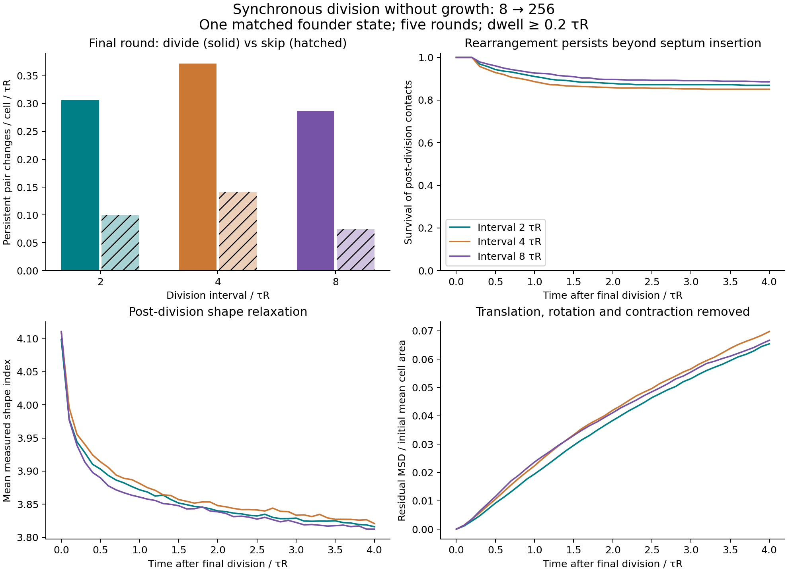
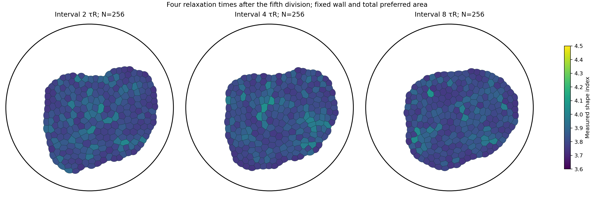
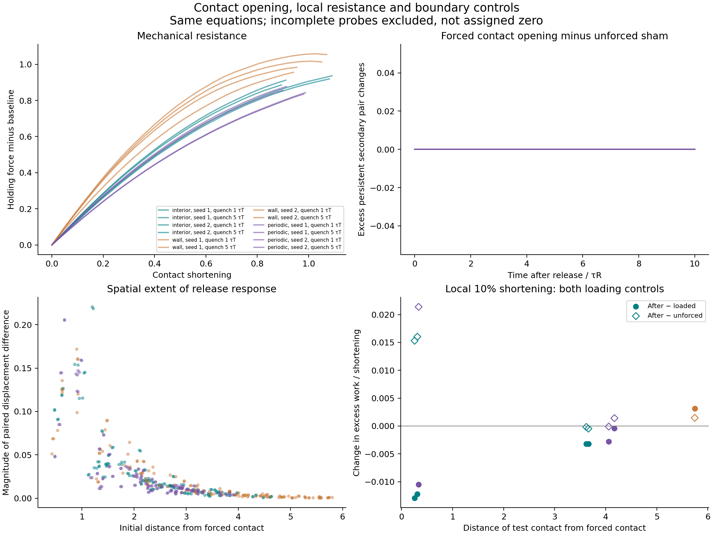
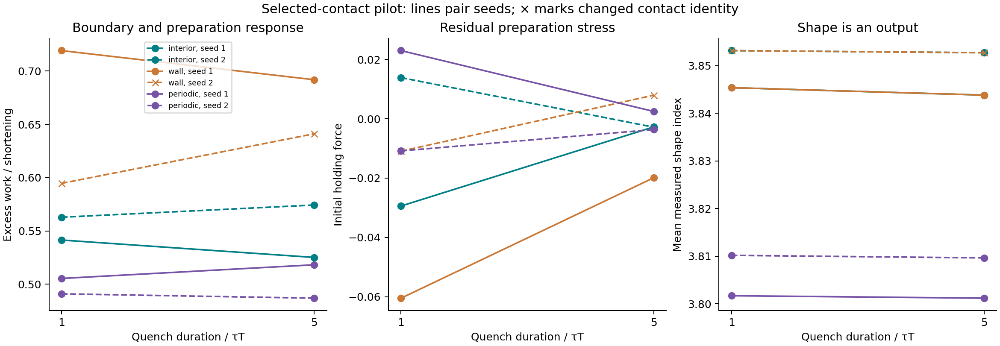
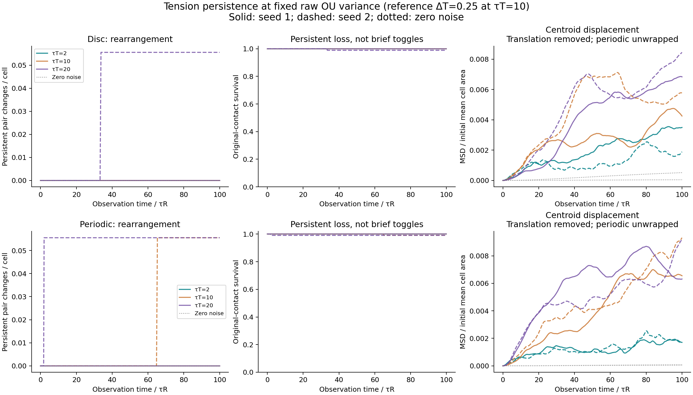

# Collective-dynamics pilot results

These are controlled finite-time experiments with the unchanged foam equations and rigid one-sided wall. The disc surface is flat. No energy or target shape index is introduced. All runs, including preemptions and geometry failures, are retained.

## Synchronous division without growth

One identical eight-cell founder state; five synchronous rounds to 256. The table covers the same four relaxation times after the final division. The skipped-final-division control has 128 cells. Pair loss and gain count separately; changes must persist for 0.2 relaxation times.

| Interval / τR | Divide: pair changes | Skip: pair changes | Divide rate / cell / τR | Skip rate | Rate ratio | Final shape index | Contact survival |
|---:|---:|---:|---:|---:|---:|---:|---:|
| 2 | 314 | 51 | 0.3066 | 0.0996 | 3.08 | 3.8160 | 0.870 |
| 4 | 381 | 72 | 0.3721 | 0.1406 | 2.65 | 3.8208 | 0.851 |
| 8 | 294 | 38 | 0.2871 | 0.0742 | 3.87 | 3.8123 | 0.886 |

Division creates substantial transient remodeling in these runs. These windows do not establish sustained fluidity after driving stops. There is only one founder realization, and dividing versus skipping changes cell number. All runs conserve total preferred area at 8 and hold the wall fixed; actual cell area may relax.

Dwell sensitivity (divide / skip counts):

| Interval | Dwell 0.1 | Dwell 0.2 | Dwell 0.5 | Maximum tolerated microfold count |
|---:|---:|---:|---:|---:|
| 2 | 847 / 165 | 314 / 51 | 99 / 16 | 67 |
| 4 | 972 / 197 | 381 / 72 | 126 / 5 | 83 |
| 8 | 774 / 127 | 294 / 38 | 81 / 1 | 55 |

No resolved crossing is accepted by the disc checks. Tolerated local microfolds remain; the 256-cell results have not been independently converged under mesh/timestep refinement. The interval-four rerun matches the historical saved polygons exactly. The old count of 184 final-generation persistent changes becomes 381 when zero-duration within-step reversals are grouped before applying physical dwell. The historical grouped log and the new observer agree at all three dwell thresholds; this is a measurement change, not changed dynamics.

## Local exchange, propagation and facilitation

N=36, W=1, rho=1.3; two seeds; quenches 1 and 5 τT. Selected contacts are the longest eligible ones, with at most two candidates. This sample cannot establish a population barrier distribution.

| Domain/layer | Seed | Quench / τT | Contact pair | Excess work / shortening | Initial shape index | Outcome | Secondary excess changes |
|---|---:|---:|---|---:|---:|---|---:|
| interior | 1 | 1 | [9, 23] | 0.5415 | 3.8454 | reversal | 0 |
| interior | 1 | 5 | [9, 23] | 0.5251 | 3.8438 | reversal | 0 |
| interior | 2 | 1 | [0, 33] | 0.5629 | 3.8532 | reversal | 0 |
| interior | 2 | 5 | [0, 33] | 0.5743 | 3.8527 | reversal | 0 |
| wall | 1 | 1 | [0, 33] | 0.7191 | 3.8454 | reversal | 0 |
| wall | 1 | 5 | [0, 33] | 0.6918 | 3.8438 | reversal | 0 |
| wall | 2 | 1 | [2, 25] | 0.5947 | 3.8532 | reversal | 0 |
| wall | 2 | 5 | [4, 14] | 0.6411 | 3.8527 | reversal | 0 |
| periodic | 1 | 1 | [9, 19] | 0.5055 | 3.8017 | reversal | 0 |
| periodic | 1 | 5 | [9, 19] | 0.5183 | 3.8012 | reversal | 0 |
| periodic | 2 | 1 | [6, 12] | 0.4910 | 3.8102 | reversal | 0 |
| periodic | 2 | 5 | [6, 12] | 0.4870 | 3.8096 | reversal | 0 |

In 12 of 12 cases both opposite faces are extracellular space. The imposed foam T1 opens the selected contact; it does not immediately create a four-cell neighbor swap. All reported reversals are contact reclosures. The work therefore measures resistance to contact opening along this protocol, not a demonstrated barrier to a lasting four-cell exchange.

Only 8 of 24 local before/after/sham triples have three complete curves. The others preempt or fail to settle and cannot supply a quantitative facilitation difference.

Secondary changes exclude pairs directly modified by the imposed T1 and subtract the matched unforced sham. A release-without-T1 control is also saved. Complete force contractions can still lead to reversal rather than a lasting exchange.

Local facilitation measures resistance to 10% shortening of a common nearby or distant contact. Its comparison with the loaded-before-T1 state and its comparison with the unforced sham answer different questions. Negative after-minus-loaded values alone do not show that the tissue has become softer than its unforced state. All three local curves must converge for a difference to enter the plot. Missing/preempted curves are not zeros.

## Tension persistence at fixed variance

Reference ΔT=0.25 at τT=10, W=1.5, rho=1.3. All 12 weak-noise cases complete. The exact Euler raw contact variance is fixed at 0.00312578, with the original half-amplitude free-boundary noise. Each run burns for 5 τT and is observed for 100 τR. Table entries show the two seeds separately. MSD removes translation and unwraps periodic trajectories; these endpoint displacements are not diffusion coefficients.

| Domain | τT | Persistent pair changes, seeds 1 / 2 | Final MSD / mean initial cell area, seeds 1 / 2 |
|---|---:|---|---|
| disc | 2 | 0 / 0 | 0.00349 / 0.00189 |
| disc | 10 | 0 / 0 | 0.00425 / 0.00577 |
| disc | 20 | 0 / 2 | 0.00683 / 0.00845 |
| periodic | 2 | 0 / 0 | 0.00170 / 0.00175 |
| periodic | 10 | 0 / 2 | 0.00655 / 0.00932 |
| periodic | 20 | 0 / 2 | 0.00631 / 0.00921 |

Longer persistence produces larger displacements in this small pilot, but contact rearrangement is rare. All four zero-noise controls have zero persistent pair changes. Two seeds and a finite observation window do not establish a fluid/solid phase boundary.

## Failed regimes and numerical checks

| Reference ΔT at τT=10 | Completed / attempted activity cases |
|---:|---:|
| 0 | 4 / 4 |
| 0.25 | 12 / 12 |
| 0.5 | 7 / 12 |
| 3 | 0 / 12 |

Failed geometry is a numerical limitation, not evidence of melting. The selected refinement check keeps the initial prepared state, halves dt to 0.0025 and spacing to 0.05, and preserves the same raw OU variance. It does not share a Brownian path with the coarser run.

| Domain | Reference ΔT | Refined result |
|---|---:|---|
| disc | 0.5 | failed: ValueError: 2 resolved film crossing(s); films 40, 255 at (13.2928, 16.0283); local-junction distance inf |
| disc | 3 | failed: ValueError: resolved boundary crossing: junction distance 0.148379 at elapsed time 2 tau_R |
| periodic | 0.5 | complete: completed observation |
| periodic | 3 | failed: ValueError: resolved boundary crossing: junction distance 0.120579 at elapsed time 1.5 tau_R |

The mechanical reference gates pass in both domains: maximum work change 1.12% across step-count, hold-window and timestep refinements, and maximum weak-pulse discrepancy 0.36%. Input state, RNG and cache identity preservation are covered by tests. The existing full suite passed 196 tests; the expanded measurement file separately passed four tests.

Periodic trajectories use the existing planar geometry validation, which lacks the disc’s independent global crossing/nesting audit. Together with selected contacts, few seeds and unconverged high-activity geometry, this limits quantitative claims about boundary stiffening.

Protocol and commands: [COLLECTIVE_EXPERIMENTS.md](../../../circle/COLLECTIVE_EXPERIMENTS.md). Detailed failures and per-case statistics: [summary.json](summary.json).
