# Exploratory dynamics experiments

96 of 137 runs completed their scheduled geometry checks. Passing sampled checks is not proof of continuous validity or numerical convergence.

| Family | Completed / attempted |
|---|---|
| refinement | 0 / 8 |
| adhesion_activity | 33 / 54 |
| opening_spaces | 4 / 12 |
| persistence_fixed_amplitude | 12 / 12 |
| persistence_fixed_variance | 12 / 12 |
| long | 3 / 6 |
| pulse | 24 / 24 |
| geometry | 8 / 9 |

Additional validation audit: 6/6 selected baseline runs pass checks at every timestep after preparation. Their stored trajectories and event records match the corresponding ordinary runs exactly. This does not certify the unmonitored preparation intervals or every other experiment.

## Protocol and interpretation

Three seeds per scientific point (two in the refinement gate). Errors and bands are seed SD, not uncertainty from treating cell-frames as independent. A point with one accepted seed has no estimated seed SD. Failed trajectories are omitted from observable averages and remain in the outcome table; complete-case selection can bias the surviving sample.

Preparation retains the established checks every 0.5 τR; transient unresolved crossings were found when testing a finer preparation check interval. Measurement and warmup are checked every 0.5 τR except the high-activity refinement gate, which checks every timestep. Microfold tolerance and transition guards were not loosened.

The original force law and OU normalization are unchanged. μ is ΔT/T₀ under unit white-noise covariance in code time units. The persistence variance match uses the Euler–Maruyama stationary variance. Measurements distinguish transactions, lost/gained contacts, initial-neighbor overlap and unbroken survival.

The observer records outer committed topology transactions, suppressing nested events rolled back by a parent. Internal suboperations within one outer transaction are coalesced; pair changes are also checked every scheduled timestep. Raw event and right/left-censored contact-episode records are saved in each compressed run.

The ellipse preserves container area and cell count. It uses Euclidean closest-point wall projection and an affine-deformed seed network followed by relaxation; global anisotropy and local curvature still covary. Circle-only traction profiles must not be reused as ellipse arclength profiles.

Complete same-seed pulse/sham pair counts: `{"100:pulse": 3, "100:sector": 3, "100:wall": 3, "36:pulse": 3, "36:sector": 3, "36:wall": 3}`.

Contact-specific tension–length lag correlations need persistent film lineage IDs across transitions and remain deferred. Current tension correlations are cell-averaged. Mechanosensitive feedback, spatially correlated noise, growth/division and osmotic forcing remain separate extensions.

Core source SHA256: `8e0dcc59950a6bdafd235161589a8214948c23d8ac82c152dda78309bb5a1cde`.

## Figures

### Adhesion and activity: rearrangements, shape and contact memory

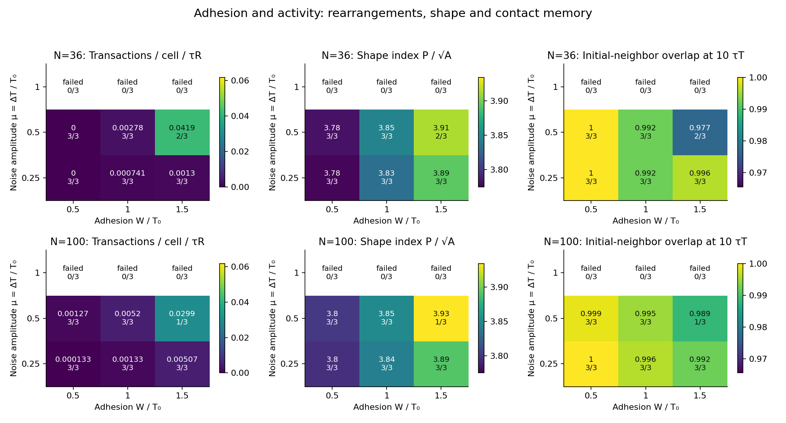

ρ=1.2, τT=10 τR, 5 τT warmup and 10 τT observation. Each tile is a mean over completed seeds; labels show accepted/attempted seeds. Failed trajectories are excluded, never assigned zero.

### Persistence and fluctuation variance are separate controls

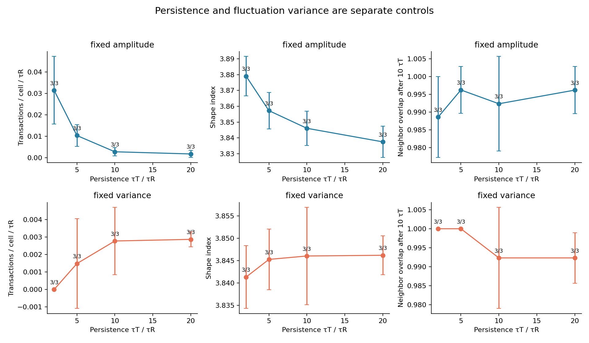

Mean ± seed SD. Fixed amplitude uses μ=0.5; fixed variance uses μ=0.5√[(2τT−dt)/(20−dt)]. This matches raw stationary Euler–Maruyama variance for a persistent contact, not its rectified effective force. All variants share τT=10 preparation. Durations scale with τT; τT=10 controls are duplicate runs, not independent replicas.

### Long trajectories: cage motion, contact memory and stationarity

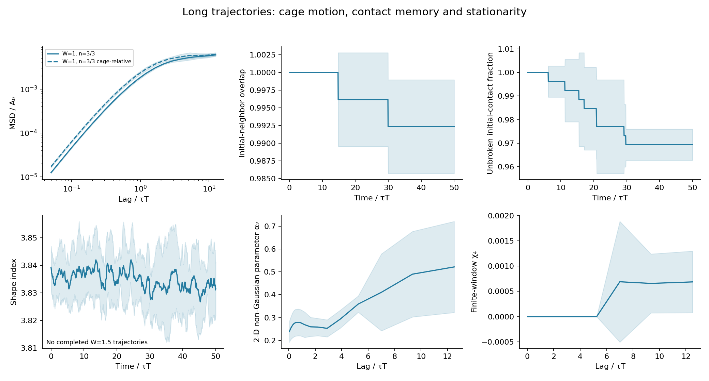

N=36, ρ=1.2, μ=0.5. Burn-in 20 τT; observation 50 τT. Bands are seed SD. Cage neighbors are fixed at measurement start. χ₄ uses correlated time origins within each trajectory and is not an ensemble susceptibility. Re-formed initial contacts count in overlap but not in unbroken survival.

### Uniform and localized activity pulses, paired against a sham

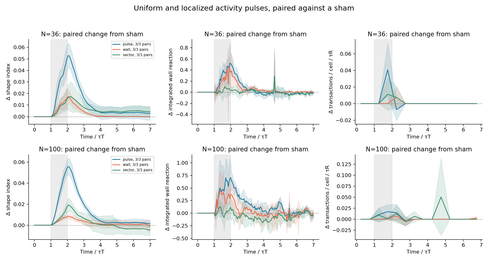

Baseline μ=0.25; μ=1 during t/τT∈[1,2). Wall activation selects film centroids within one code-length unit of the circular wall; sector activation covers ±π/4. Curves subtract the same-seed sham, using only pairs whose full trajectories completed. Bands are SD across paired seeds; missing pairs can bias the surviving sample. The protocols have equal peak amplitude but are not matched for total noise input or activated film count.

### Equal-area circle and ellipses

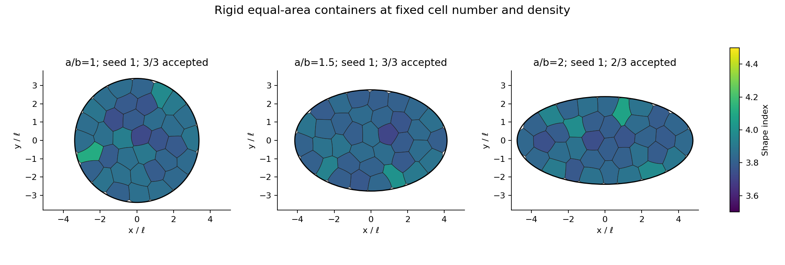

N=36, ρ=1.2, W=1, μ=0.5; all walls have area 36 in code units. Final frames at 10 τT after 5 τT warmup; same-seed examples where available. Ellipse initialization is an area-preserving deformation of the circular tiling, followed by relaxation. Container shape also changes global confinement and orientation; these are not isolated local-curvature interventions.

### Shape of the container at fixed area, N and preferred cell area

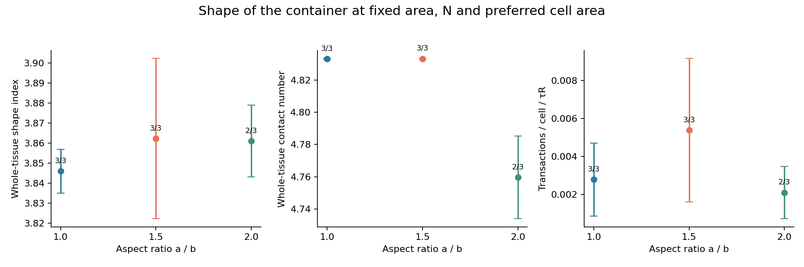

Means ± seed SD over completed trajectories. The ellipse projection uses its actual surface normal. Local-curvature profiles are exported separately; wall distance for ellipses uses a 1024-point wall sample.

### Near-wall structure versus local curvature in equal-area containers

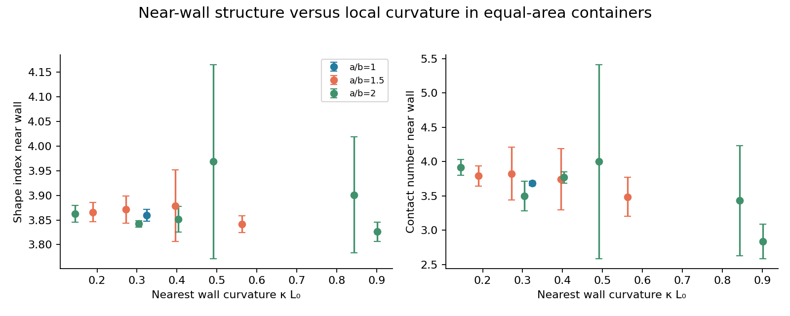

Centroids within L₀ of the wall. First average cell-frames within each seed and curvature bin; error bars are SD across seeds. Curvature is that of the nearest sampled wall point; markers use the seed-averaged curvature within each bin. Global shape, wall orientation and local curvature covary; this association alone does not establish causality.

### Lower adhesion and density: packing, contacts and wall attachment

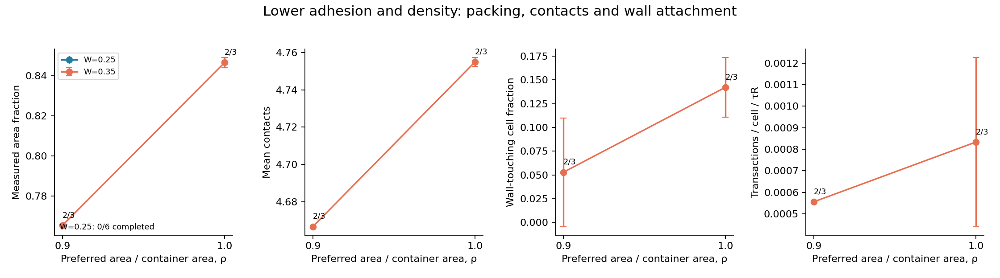

N=36, μ=0.5; 5 τT warmup and 10 τT observation. Mean ± seed SD. Nominal density ρ is a control parameter, whereas packing is measured. Failed geometries are excluded and their counts are reported.

### Resolved neighbor changes and clustering diagnostics

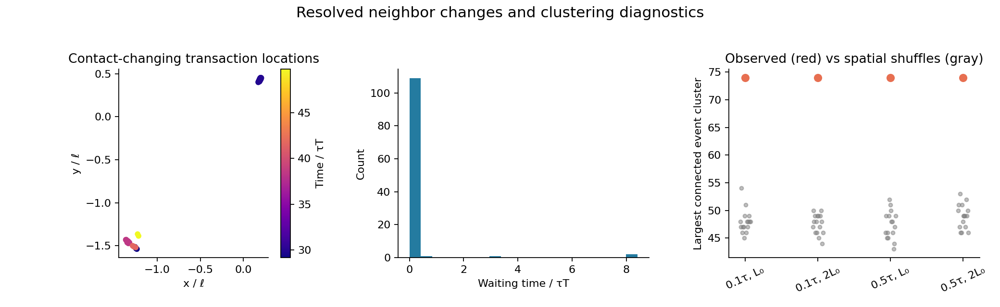

Illustrative completed long run chosen for the largest event count in that family: N=36, W=1.0, μ=0.5, seed=3; 114 contact-changing transactions. This is not an unbiased example. Events connect within both distance and time cutoffs; nulls shuffle observed positions across fixed event times (16 shuffles). Large clusters or back-to-back reversals are not by themselves evidence for physical avalanches.

### High-activity numerical gate: first detected failure under refinement

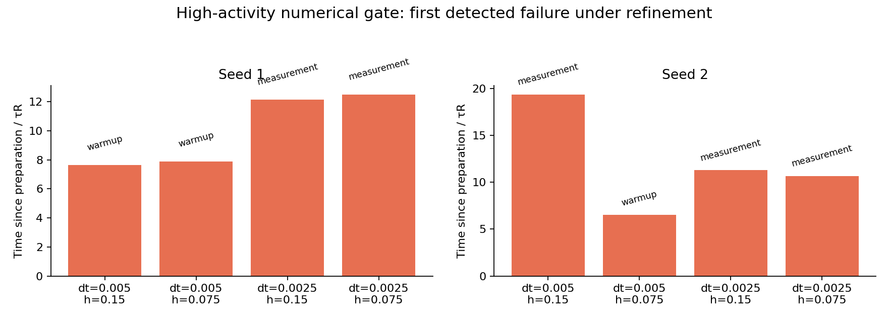

N=36, W=1, ρ=1.3, μ=1.5. Geometry checked every timestep after preparation; preparation retains checks every 0.5 τR. Bars report time after preparation to the first failed check; labels identify the stage. This is not a physical instability threshold. Seed labels are shared but Brownian paths and initial meshes are not coupled under refinement. These short first-passage comparisons cannot establish stochastic convergence.

### Tension–shape lags and spatial organization

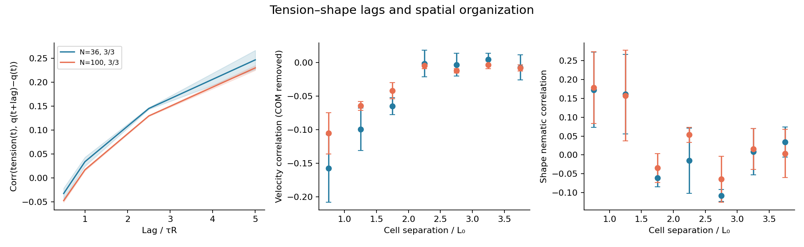

W=1, ρ=1.2, μ=0.5; completed seeds, means ± seed SD. Tension is a length-weighted incident-film average per cell, not a tracked contact tension. Lag correlations are descriptive, not causal. Spatial velocities have instantaneous whole-tissue translation removed; shape tensors come from polygon area moments. Pair counts do not represent independent replicas.

### Frequent events need not imply lasting neighbor exchange

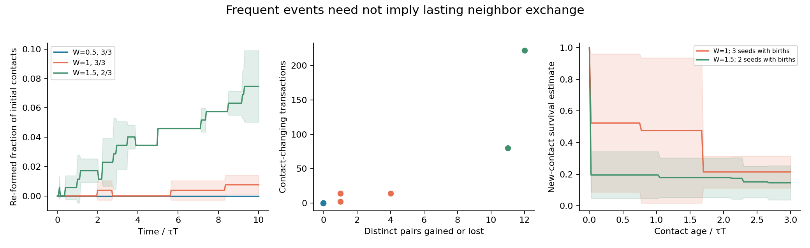

N=36, ρ=1.2, μ=0.5. Left: initial-neighbor overlap minus unbroken survival identifies re-formed contacts. Middle: each dot is one completed seed; repeated changes can involve only a few distinct cell pairs. Right: product-limit survival of contacts born during observation, excluding initial left-censored episodes and retaining right censoring. Curves average seed estimates, not pooled contact episodes; bands are seed SD. Sampled wall-contact residence episodes are exported separately and have 0.5 τR resolution, including possible remeshing-induced flicker.

### Where deformation and neighbor changes occur

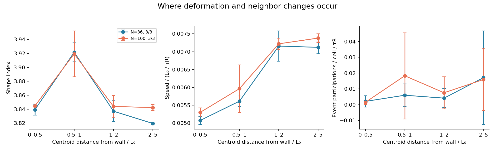

W=1, ρ=1.2, μ=0.5; mean ± seed SD. Event participation counts each affected cell once per contact-changing transaction and divides by observed cell-time in the distance bin. Bins use the preceding stored cell centroids (0.5 τR resolution). The CSV also separates cells with and without any free film: distance from the container wall alone does not identify tissue interior.

