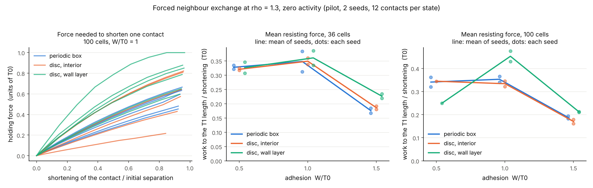

# Forced neighbour exchange: disc against a matched periodic box (pilot)

Script: `circle/scripts/probe_pilot.py`. Data: `circle/data/probe_20261114/records.json`.
Method and limits: `circle/PROBE.md`. Two seeds per point, 12 contacts per prepared state,
`rho = 1.3`, zero activity, `dt = 0.005`, film spacing 0.15. 23 of 24 prepared states were
accepted; the 100-cell disc at `W/T0 = 0.5`, seed 1, failed preparation on a resolved film
crossing and is excluded.

"Mean resisting force" is the work to shorten a contact to the T1 length divided by the
shortening, averaged over contacts within a state and then over seeds (values per seed in
brackets). Outcomes count probes, including preempted ones.

| cells | W/T0 | domain, zone | contacts | mean resisting force | stiffness | outcomes |
|---|---|---|---|---|---|---|
| 36 | 0.5 | periodic | 23 | 0.328 (0.334, 0.321) | 2.11 | 19 reversal, 3 exchange, 1 space, 1 preempted |
| 36 | 0.5 | disc, interior | 10 | 0.320 (0.317, 0.324) | 2.12 | 9 reversal, 1 exchange, 2 preempted |
| 36 | 0.5 | disc, wall layer | 8 | 0.326 (0.345, 0.307) | 2.22 | 5 reversal, 3 exchange |
| 36 | 1.0 | periodic | 24 | 0.348 (0.383, 0.312) | 1.51 | 21 reversal, 3 exchange |
| 36 | 1.0 | disc, interior | 12 | 0.349 (0.360, 0.338) | 1.55 | 12 reversal |
| 36 | 1.0 | disc, wall layer | 12 | 0.361 (0.386, 0.335) | 1.72 | 12 reversal |
| 36 | 1.5 | periodic | 24 | 0.176 (0.184, 0.167) | 0.90 | 20 reversal, 4 exchange |
| 36 | 1.5 | disc, interior | 12 | 0.186 (0.192, 0.180) | 0.89 | 11 reversal, 1 exchange |
| 36 | 1.5 | disc, wall layer | 12 | 0.226 (0.219, 0.234) | 1.06 | 12 reversal |
| 100 | 0.5 | periodic | 24 | 0.341 (0.362, 0.320) | 2.13 | 22 reversal, 2 space |
| 100 | 0.5 | disc, interior | 3 | 0.345 (one seed) | 2.20 | 3 reversal, 3 preempted |
| 100 | 0.5 | disc, wall layer | 4 | 0.249 (one seed) | 2.52 | 4 reversal, 1 preempted |
| 100 | 1.0 | periodic | 24 | 0.353 (0.340, 0.366) | 1.54 | 20 reversal, 4 exchange |
| 100 | 1.0 | disc, interior | 10 | 0.334 (0.322, 0.346) | 1.43 | 10 reversal, 2 preempted |
| 100 | 1.0 | disc, wall layer | 12 | 0.453 (0.475, 0.430) | 1.70 | 12 reversal |
| 100 | 1.5 | periodic | 24 | 0.188 (0.182, 0.194) | 0.92 | 24 reversal |
| 100 | 1.5 | disc, interior | 12 | 0.170 (0.179, 0.161) | 0.83 | 9 reversal, 3 exchange |
| 100 | 1.5 | disc, wall layer | 12 | 0.212 (0.213, 0.210) | 1.15 | 10 reversal, 1 exchange, 1 space |

## What can and cannot be read from this

The two probe implementations agree only to about 3–4% on the holding force, so
differences of that size between conditions are not interpretable.

- **Interior of the disc against the periodic box.** The mean resisting force differs by
  0.3% to 10% across the six comparisons, with no consistent sign, and the two seeds of a
  single condition differ by up to 20%. No difference is resolved.
- **Wall layer.** At `W/T0 = 1.5` the wall-layer value is above the interior in both sizes
  (0.226 against 0.186, and 0.212 against 0.170), and at 100 cells and `W/T0 = 1` it is 0.453
  against 0.334. At `W/T0 = 0.5` it is not higher. This is a candidate effect in the
  direction the paper reports for a bounded flat disc, from two seeds; it is not established.
- **Adhesion.** The mean resisting force is about half as large at `W/T0 = 1.5` as at 0.5 or
  1.0 in every domain. Contact tension is `2 T0 - W`, so this is expected from the force law.
- **Outcomes.** After the model's T1 operation and 10 tau_R of free evolution, the original
  contact came back in 85% or more of completed probes in most conditions. The forced
  exchanges mostly reverse.

No statement about a fluid or solid state follows from these numbers.
